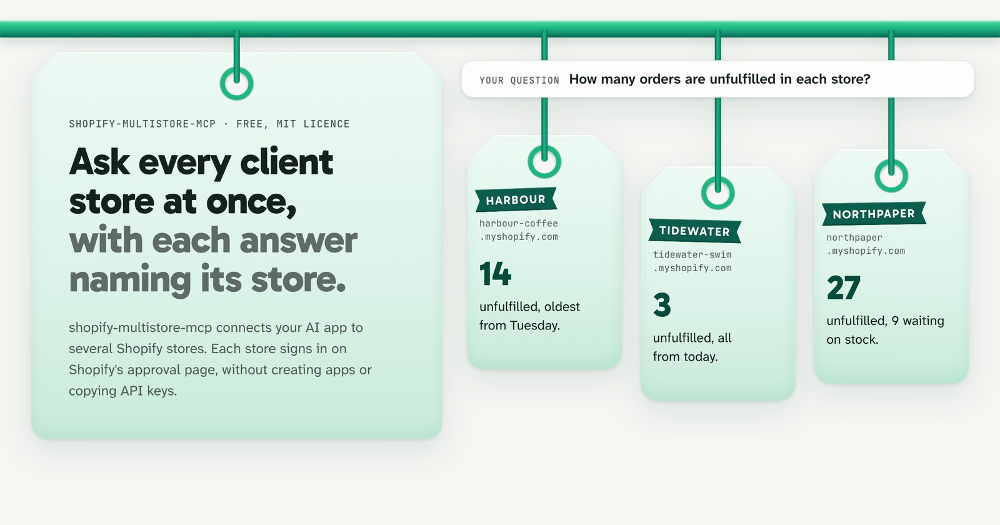

<p align="center"></p>

<h1 align="center">shopify-multistore-mcp</h1>

<p align="center"><strong>Every client store in one AI chat. Each answer says which store it came from.</strong></p>

<p align="center">Free and open source (MIT) · works with Claude Desktop, Claude Code, Cursor, VS Code, Windsurf and Codex · not affiliated with Shopify</p>



**shopify-multistore-mcp** lets one AI assistant work across several Shopify stores at the same time. Ask a question once and every connected store answers, with each reply starting with the store it came from, such as `store: harbour (harbour-coffee.myshopify.com)`, so a figure never lands on the wrong client. You connect stores through Shopify's own approval page in your browser, without creating custom Shopify apps or handing API keys around.

We built it for Shopify agencies, freelancers and account managers who look after several client stores, many of whom aren't developers. It also suits store owners running 2-6 shops of their own.

## Why it exists

Shopify's own AI connector holds one store at a time. As a Shopify staff member wrote on the Shopify Developer Community forum on 7 October 2026: "The Shopify connector supports one store at a time, even when the stores are in the same organization. Switching stores starts a new authorization."

If you look after a roster of client stores, that means re-approving access every time you switch clients, and never comparing two stores inside the same chat. shopify-multistore-mcp keeps every connected store available together in one conversation.

Shopify's web admin switches between stores without any trouble; that one-store limit sits solely in the AI connector.

## What you can ask

Once your stores are connected, you ask your assistant questions in plain English. shopify-multistore-mcp asks your connected stores side by side, four at a time. For example:

- "How many orders are still waiting to be fulfilled in each store, and which order has been waiting longest in each?"
- "What did each store sell over the last 7 days? Leave out cancelled and test orders, and give each total in the store's own currency."
- "Compare SKU HB-BEANS-1KG across all my stores: price, compare-at price and stock in each."
- "Which active products have no image, in each store?"
- "Which of my stores sell something with 'linen' in the name, and at what price?"

Answers come back labelled by store like this:

```text
store: harbour (harbour-coffee.myshopify.com)
4 orders waiting to be fulfilled. Longest waiting: #1042.

store: tidewater (tidewater-swim.myshopify.com)
1 order waiting to be fulfilled. Longest waiting: #2190.
```

The store names and order numbers above are illustrative examples; you pick your own short nickname for each store when you connect it.

## Ready-made reports and the prompts menu

For routine agency checks, shopify-multistore-mcp includes nine ready-made reports (through its `store_report` tool). Each report runs across every connected store at once and combines the results into one reply, clearly labelled by store.

| Report | What it checks across every store |
|---|---|
| **Overview** | Store details and a top-level summary for each connected store. |
| **Sales** | Order count, total sales and average order value in each store's own currency, with test and cancelled orders left out. |
| **Unfulfilled orders** | Waiting orders grouped by age; counts partially fulfilled orders as waiting, matching Shopify admin's Unfulfilled view. |
| **Low stock** | Products running low in each store, alongside which other connected store has stock available to move. |
| **Find a product** | Matches a product by SKU, handle or name across every store, showing price, compare-at price and stock. |
| **Catalogue gaps** | Products missing from some stores, plus status mismatches between stores. |
| **Catalogue health** | Products with no image, missing alt text, empty description, no SEO description, no product type or a zero price. |
| **Duplicate SKUs** | SKUs used by more than one product or variant inside the same store. |
| **Recently changed products** | Products updated recently across your stores. |

Apps like Claude Desktop also show seven ready-made prompts in their prompts menu so you don't have to type from scratch: **morning check**, **sales**, **unfulfilled orders**, **low stock**, **compare a product**, **catalogue check** and **connect a store**.

For anything outside those nine reports, your assistant can run read-only Admin GraphQL queries on one store or across every store at once. shopify-multistore-mcp also passes through Shopify's own Dev MCP so your assistant can look up Shopify's API docs and check a query before running it.

## How it compares

Instead of claiming shopify-multistore-mcp handles multi-store questions well, we measured it head to head against the closest open-source alternative, [alex-brecher/shopify-multi-store](https://github.com/alex-brecher/shopify-multi-store) (published as Shopify Multi-Store MCP, npm `shopify-multi-store-mcp-server` 2.0.3, MIT), and published the test suite so anyone can re-run it.

| Measure | shopify-multistore-mcp 0.3.0 | alex-brecher/shopify-multi-store 2.0.3 |
|---|---|---|
| Questions answered correctly | **30 of 30 (100%)** | 27 of 30 (90%) |
| Tool calls per question (median) | **1** | 2 |
| Time per question, end to end (median) | **7.4 s** | 8.8 s |
| Model cost per question (median) | **2.3¢** | 3.7¢ |
| Tools in the list sent with every message | 14 (~10k tokens) | 29 (~12k tokens) |
| One store's details, one call | 526 ms | **5 ms** |
| Unfulfilled orders across 3 stores | 541 ms | **7 ms** |
| Unfulfilled orders across 8 stores | 1.1 s | **12 ms** |
| Installed size | 28 MB, plus 397 MB of Shopify's CLI and Dev MCP on first start | **32 MB** |

On 31 October 2026, both servers ran against the same local mock of Shopify's Admin API, which validates every request against Shopify's published schema (198 requests, 0 rejected) and answers from the same three stores (`harbour`, `tidewater` and `northpaper`). The alternative ran from its published npm package in a sandboxed container, while shopify-multistore-mcp ran through a stand-in for Shopify's CLI that waits the measured 0.47 s per call; neither side paid network time to Shopify. Claude Sonnet 5.5 (in Claude Code, with no other tools) answered the same 10 multi-store questions 3 times per server, graded by script against figures calculated from the data, while speed rows show the median of 7 runs. Asking stores four at a time cut shopify-multistore-mcp's unfulfilled-orders check from 1.6 s to 541 ms across 3 stores (and from 4.2 s to 1.1 s across 8 stores) compared with version 0.2. Note: these results come from mock stores rather than live shops, using one AI model and 10 questions written by the shopify-multistore-mcp team.

alex-brecher/shopify-multi-store is a good tool that does more than shopify-multistore-mcp in several areas:

- **Faster raw API calls:** It calls Shopify's Admin API directly over HTTPS (5 ms to 12 ms above), whereas shopify-multistore-mcp starts Shopify's CLI on each call (about 0.47 s) so it never touches access tokens itself.
- **Team hosting and browser chat:** You can host it on Cloudflare Workers or Docker with per-person Shopify staff sign-in, making it usable from ChatGPT and claude.ai in the browser. shopify-multistore-mcp runs strictly on your own computer.
- **Smaller install:** It installs in 32 MB, without downloading Shopify's CLI and Dev MCP.
- **More reports and write tools:** It offers 29 tools, 17 ready-made reports, guided write tools and generic tools reaching all 514 Admin mutations (API 2026-04).

Where the two differ in shopify-multistore-mcp's favour: connecting a store there means creating a Shopify app in the Dev Dashboard (setting scopes, releasing a version, installing it and copying client secrets for OAuth) or creating a custom admin app and copying its `shpat_` token into your keychain. It has no MCP prompts or per-store read-only switch, and it pins Admin API 2026-07, where shopify-multistore-mcp follows Shopify CLI onto the newest stable version (2026-10).

Full method, per-question scores and raw logs live in [evals/README.md](evals/README.md) and [evals/results/SUMMARY.md](evals/results/SUMMARY.md).

## Is it safe?

- **It never reads or copies a Shopify token.** You don't build a custom app or copy `shpat_` tokens. Each store signs in on Shopify's own approval page through Shopify's own CLI, which keeps that store's sign-in in its own folder on your computer. Removing a store deletes that folder.
- **Questions can't edit a store.** Reading and changing are kept separate. Edits go through a single change tool, one named store at a time. Throttled reads are retried automatically; changes are never retried, so an edit can't be applied twice.
- **Any store can be locked to read-only.** Turning on read-only for a store refuses every change, whatever your assistant asks for. I reckon read-only is the sensible default for client stores where nobody has signed off on AI edits.
- **Sensitive account changes are blocked outright.** Even on stores where edits are enabled, changes that would create access tokens, charge the store or alter app access are refused.
- **Updates to Shopify's tools are verified before use.** shopify-multistore-mcp runs the newest release of Shopify's CLI and Dev MCP, switching over only after three checks pass: npm integrity, registry signatures and a start-up test. If a new release fails a check, the last working version keeps running.
- **Store figures in answers go to your AI provider.** Data needed to answer your question is sent to your AI app's provider as part of the conversation, as with any AI connector. Nothing goes to fledgeling.
- **Every line of code is open source.** Anyone on your team can inspect it in this repository under the MIT licence.

## What you need

- **A Mac, Windows or Linux computer.** shopify-multistore-mcp runs locally on your machine, not in the cloud.
- **Node.js 22.12 or newer.** Open Terminal (Mac) or Command Prompt (Windows) and run `node --version` to check; if it's older than 22.12 or missing, install the LTS version from [nodejs.org](https://nodejs.org).
- **A supported AI app:** Claude Desktop, Claude Code, Cursor, VS Code, Windsurf or Codex. Browser tabs like claude.ai can't run local tools.
- **A Shopify login able to approve app access on each store**, plus a web browser on the same computer.
- **About 400 MB of free disk space** for Shopify's CLI and Dev MCP on initial start.

## Set it up

Open Terminal (Mac) or Command Prompt (Windows) and run one command:

```bash
npx -y shopify-multistore-mcp@latest setup
```

`setup` checks that Node.js is 22.12 or newer, finds the supported AI apps installed on your computer, and adds shopify-multistore-mcp to each one. It backs up every settings file before editing it, and never touches a file it can't read.

Next, `setup` asks for each store's `.myshopify.com` address and opens Shopify's approval page in your browser so you can sign in. Once you reopen your AI app, initial start downloads Shopify's own CLI and Dev MCP (about 400 MB; roughly 30 seconds on our test machine).

You can also connect additional stores later straight from your chat:

> Connect acme.myshopify.com as acme

To lock a store against edits when connecting it from chat, include `read-only`:

> Connect acme.myshopify.com as acme, read-only

### Prefer to set it up by hand?

If you'd rather edit config files yourself instead of running `setup`, add the matching block below and restart your AI app.

**Claude Desktop, Cursor and Windsurf**

```json
{
  "mcpServers": {
    "shopify-multistore-mcp": {
      "command": "npx",
      "args": ["-y", "shopify-multistore-mcp@latest"]
    }
  }
}
```

**VS Code**

```json
{
  "servers": {
    "shopify-multistore-mcp": {
      "type": "stdio",
      "command": "npx",
      "args": ["-y", "shopify-multistore-mcp@latest"]
    }
  }
}
```

**Claude Code**

```bash
claude mcp add shopify-multistore-mcp -- npx -y shopify-multistore-mcp@latest
```

**Codex** (`~/.codex/config.toml`)

```toml
[mcp_servers.shopify-multistore-mcp]
command = "npx"
args = ["-y", "shopify-multistore-mcp@latest"]
```

## Everyday use

- **Add another store** whenever you take on a client by saying `"Connect acme.myshopify.com as acme"` in chat, or by running `setup` again.
- **Sign in again** if a store's session expires; your assistant will name the store that needs re-approval.
- **Ask one store or all of them** by naming a store (`"at harbour"`) or asking across the lot (`"in each store"`).
- **Remove a store** by running `npx -y shopify-multistore-mcp@latest remove <name>` in your terminal, which deletes that store's sign-in folder from your computer.
- **Check everything is working** by running `npx -y shopify-multistore-mcp@latest doctor` to verify Shopify's tools and store sign-ins.

## If something goes wrong

| What you see | What to do |
|---|---|
| Your assistant doesn't know about shopify-multistore-mcp or your stores | Fully quit and reopen your AI app after setup. If you edited config by hand, check for missing commas or brackets, or run `npx -y shopify-multistore-mcp@latest doctor`. |
| "Shopify CLI is still installing" | Normal on initial start while Shopify's CLI and Dev MCP finish downloading (about 30 seconds on our test machine). Wait a minute and ask again. |
| "Store … is not signed in, or its session expired" | Ask your assistant to connect that store again and approve it in your browser. |
| No browser window opens when connecting | Check whether your assistant printed an approval link and open it in a browser on the same computer. |
| The approval page refuses or shows an error | Your collaborator or staff login may not have permission to approve apps on that store; check with the store owner. |
| "Pass store to say which store to use" | You have more than one store connected. Name the store in your question. |
| "… is read-only, so mutations are refused" | That store is set to read-only so edits are blocked. Reconnect it without `read-only` if you want changes allowed. |
| `node: command not found`, or a version error | Install Node.js 22.12 or newer from [nodejs.org](https://nodejs.org), then restart your AI app. |

If you hit anything else, please [open an issue](https://github.com/fledgeling-co/shopify-multistore-mcp/issues) with what you asked and the message that came back (strip out any client or customer details beforehand).

## Questions

**Is this an official Shopify product?**
No. shopify-multistore-mcp is an independent open-source tool from fledgeling, and isn't affiliated with or endorsed by Shopify. It uses Shopify's own CLI and Dev MCP underneath, and every store signs in on Shopify's own approval page.

**What does it cost?**
Nothing. shopify-multistore-mcp is free under the MIT licence. Your AI app's own subscription is separate.

**Does it work in claude.ai or ChatGPT in the browser?**
No. shopify-multistore-mcp runs on your own computer, so it works with desktop and terminal apps (Claude Desktop, Claude Code, Cursor, VS Code, Windsurf and Codex). If you want a hosted server for a team that works in browser chat, look at alex-brecher/shopify-multi-store.

**How does it compare with alex-brecher/shopify-multi-store?**
shopify-multistore-mcp focuses on zero app or token setup, per-store read-only locks, ready-made prompts and multi-store read accuracy (30 of 30 vs 27 of 30 on our 10-question eval). alex-brecher/shopify-multi-store is much faster per raw API call, has a smaller install, includes more reports and write tools, and supports cloud hosting for teams.

**Do I have to create a Shopify app or ask clients for API keys?**
No. You only need the store's `.myshopify.com` address and a Shopify login that can approve access in your browser.

**Can my assistant change a client store by accident?**
Questions can't make changes. Edits go through one change tool on one named store at a time, changes never retry, and token, billing and app-access changes are blocked altogether. Keep client stores on read-only unless you actively want edits enabled.

**I used Shopherd, StoreRow or shopify-multi-mcp; will my old setup break?**
No. shopify-multistore-mcp was called `shopify-multi-mcp` in 0.1, `StoreRow` in 0.2 and Shopherd in 0.3.0, and your existing settings keep working.

## Status

shopify-multistore-mcp is an early release at version 0.3.1 (website: [fledgeling-co.github.io/shopify-multistore-mcp](https://fledgeling-co.github.io/shopify-multistore-mcp/)). We've tested it end to end against Shopify's own tools and against a local mock Admin API built on Shopify's published schema, though nobody has signed in to a real store with it yet; connecting a live store is part of early testing. Earlier versions were named `shopify-multi-mcp` (0.1), `StoreRow` (0.2) and Shopherd (0.3.0); old settings still work and old links redirect here. Please report any rough edges on [GitHub Issues](https://github.com/fledgeling-co/shopify-multistore-mcp/issues).

## For developers

- [docs/TECHNICAL.md](docs/TECHNICAL.md): architecture, configuration, flags and test suite.
- [docs/REVIEW.md](docs/REVIEW.md): review of Shopify's MCP servers and connectors behind the design.
- [evals/](evals/): multi-store benchmark and agent eval harness, prompts and raw results.
- [docs/positioning/00-decision.md](docs/positioning/00-decision.md): audience research and positioning notes.
- [design/](design/): icon source, audit sheet and marketing assets.

## Licence

MIT. Not affiliated with or endorsed by Shopify. Shopify is a trademark of Shopify Inc.
